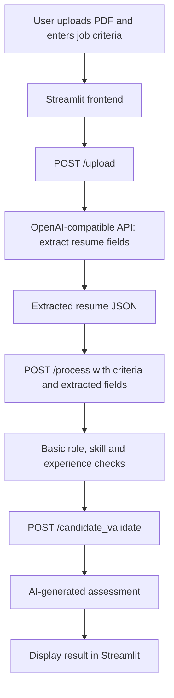

# Resume-Tool

Resume-Tool is a prototype web application for extracting structured information from PDF resumes and generating a preliminary, AI-written candidate assessment against role requirements.

## What it currently does

- Accepts a PDF resume through a Streamlit web interface.
- Sends the file to a configured OpenAI-compatible API and asks the `gpt-4.1` model to extract resume fields into JSON.
- Passes the extracted fields and user-entered role, skills, and experience criteria to a FastAPI endpoint.
- Runs basic role/skill checks and assigns a broad experience category.
- Sends the processing result to the model to produce a short HR-style assessment.

**Important:** This is an early-stage prototype, not a validated recruitment or automated hiring system. Read [Current limitations](#current-limitations) before relying on its assessment.

## Application flow



## Tech stack

| Layer | Technology |
| --- | --- |
| Frontend | Streamlit |
| Frontend-to-backend requests | Python Requests, REST/JSON |
| Backend | FastAPI, Pydantic |
| ASGI server | Uvicorn |
| AI integration | OpenAI Python SDK using a configurable `BASE_URL` |
| Model used in code | `gpt-4.1` |
| Resume input | PDF file upload |

The environment variable is named `AZURE_OPENAI_API_KEY`, but the source instantiates the generic `OpenAI` client. Configure `BASE_URL` for an endpoint compatible with the SDK operations used in the code.

## Repository structure

```text
Resume-Tool/
├── Backend/
│   ├── main.py
│   ├── requirements.txt
│   ├── schemas/
│   │   ├── extracted_fields.py
│   │   ├── file_upload.py
│   │   └── requirements.py
│   └── services/
│       ├── evaluation.py
│       ├── field_extraction.py
│       └── process.py
├── Frontend/
│   ├── app.py
│   └── requirements.txt
└── README.md
```

- `Backend/main.py`: FastAPI application and API routes.
- `Backend/schemas/`: Pydantic models for extracted resume fields, upload metadata, and job requirements.
- `Backend/services/field_extraction.py`: uploads the resume to the configured model API and requests structured field extraction.
- `Backend/services/process.py`: performs the current rule-based role, skill, and experience checks.
- `Backend/services/evaluation.py`: requests a short language-model assessment from the processing output.
- `Frontend/app.py`: Streamlit form, upload workflow, progress indicators, and result display.
- Each layer has its own pinned dependency list.

## Requirements

- Python installed and available as `python` in your terminal. Python 3.11 or newer is recommended.
- An API key and endpoint compatible with the OpenAI Python SDK methods used by the application.
- Access to the configured `gpt-4.1` model or a deployment exposed under that model name.

## Setup

### 1. Clone the repository

```bash
git clone https://github.com/Yogendiran-SP/Resume-Tool.git
cd Resume-Tool
```

### 2. Create and activate a virtual environment

**Windows PowerShell**

```powershell
python -m venv .venv
.\.venv\Scripts\Activate.ps1
```

**macOS/Linux**

```bash
python3 -m venv .venv
source .venv/bin/activate
```

### 3. Install dependencies

Run these commands from the repository root with the virtual environment activated:

```bash
python -m pip install --upgrade pip
python -m pip install -r Backend/requirements.txt
python -m pip install -r Frontend/requirements.txt
```

### 4. Configure the model endpoint

Create a file named `Backend/.env`:

```dotenv
AZURE_OPENAI_API_KEY=your_api_key_here
BASE_URL=https://your-openai-compatible-endpoint/v1/
```

Replace the example endpoint with the base URL required by your provider. For Azure OpenAI, use the endpoint format supported by your Azure resource and the OpenAI SDK. The source currently specifies `gpt-4.1` in both extraction and evaluation calls; your endpoint must expose the model or deployment under that name.

Keep credentials out of source control. Do not commit `Backend/.env` or paste secrets into issues or logs.

## Run locally

Start the backend first. From the repository root:

**Terminal 1 — FastAPI backend**

```bash
cd Backend
python -m uvicorn main:app --reload --host 127.0.0.1 --port 8000
```

The API is available at <http://127.0.0.1:8000>. Interactive endpoint documentation is available at <http://127.0.0.1:8000/docs>.

**Terminal 2 — Streamlit frontend**

From the repository root in a separate terminal, activate the same virtual environment and run:

```bash
cd Frontend
python -m streamlit run app.py
```

The frontend uses `http://localhost:8000` as its backend URL, defined by `BACKEND_URL` in `Frontend/app.py`. If the backend is hosted elsewhere, update that value before running the frontend.

## API overview

| Method | Endpoint | Purpose |
| --- | --- | --- |
| `GET` | `/` | Returns a welcome message from the API. |
| `POST` | `/requirements` | Validates and returns a job-requirements object. The current frontend does not call this route. |
| `POST` | `/upload` | Accepts a multipart upload using the `file` field; the filename must end in `.pdf`. Returns extracted resume fields as JSON. |
| `POST` | `/process` | Accepts `required` and `file` objects and returns the current rule-check results as a list. |
| `POST` | `/candidate_validate` | Accepts a JSON list of strings and returns a model-generated candidate assessment. |

### Requirements payload

The `/requirements` route uses these case-sensitive field names:

```json
{
  "Role": "Backend Developer",
  "Skills": ["Python", "FastAPI"],
  "Years_of_Experience": 2
}
```

### Processing payload

The `/process` route expects two objects named `required` and `file`. The `required` object uses the fields above. The `file` object must match the `ExtractedFields` schema, including fields such as `Name`, `Summary`, `Contact`, `Skills`, `Years_of_Experience`, `Roles`, and `Education`.

For exact request and response schemas, start the backend and open <http://127.0.0.1:8000/docs>.

## Current limitations

- **Matching is basic and literal.** The role and skill checks do not provide semantic matching, synonym handling, or a reliable required-skill coverage score.
- **Experience criteria are not directly compared.** When experience criteria are supplied, the current processing function classifies the candidate's stated years into broad categories instead of checking them against the requested number. The current thresholds also leave exactly five years without a category.
- **The final model receives limited context.** The frontend sends the list returned by `/process` to `/candidate_validate`; it does not send the full extracted resume or original requirements to that endpoint. The final assessment may therefore lack important evidence.
- **Extraction requires human review.** Model-generated fields can be missing, incorrect, or inferred. The output should be checked against the original resume.
- **File checks are minimal.** The upload route checks the filename extension, but does not verify PDF contents or enforce a file-size limit.
- **No production controls are implemented.** The current app has no authentication, authorization, rate limiting, or persistent storage, and the backend allows all CORS origins. Tighten these settings before any deployment.

Use the output as an experimental aid only. Do not make hiring decisions solely from the generated assessment, and ensure resumes are permitted to be sent to the configured model provider before uploading them.

## Troubleshooting

- **“Backend connection failed” in Streamlit:** make sure Uvicorn is running on port 8000 and that `BACKEND_URL` points to it.
- **Model/API errors:** verify `Backend/.env`, the key, endpoint URL, model/deployment name, and whether the endpoint supports file uploads, the Responses API, and Chat Completions used by the source.
- **Request validation errors:** check the case-sensitive JSON field names and the request body shape in the interactive API documentation.
